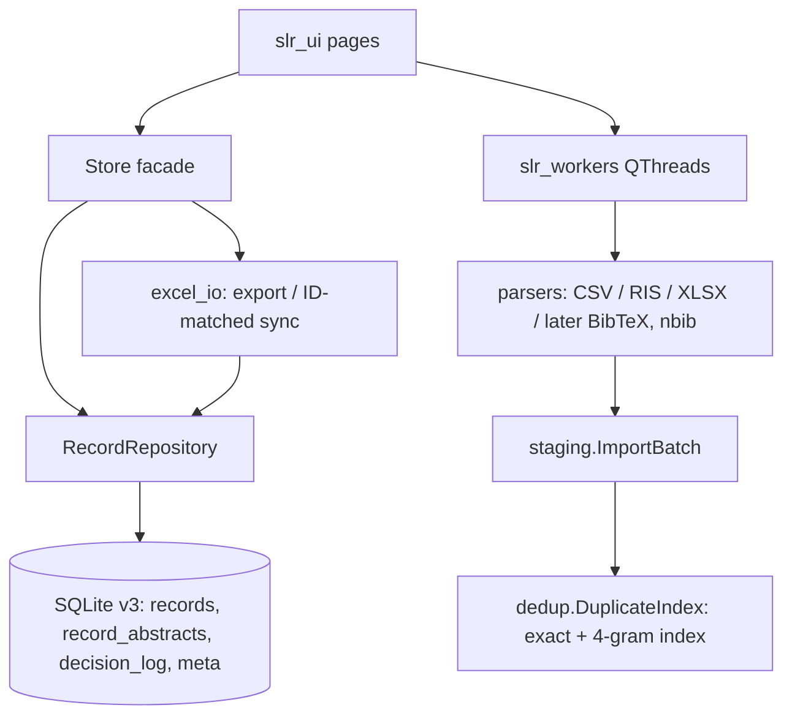

# SLR Assistant – Audit report

Scope: every `.py` file in the project (≈ 4,000 lines), the sample IEEE export
and the (empty) project database. Method: read all code, run the suite
(baseline 42 tests green), reproduce suspected problems with scripts before
touching anything, fix, re-test (now 88 tests green).

## 1. Understanding

**What it is** – a local PySide6 desktop app (single user, SQLite project file)
for the *record-handling* part of an SLR: import CSV/RIS/XLSX database exports →
DOI-first + fuzzy-title de-duplication → title/abstract and full-text screening
(table view and keyboard "focus" view) → PRISMA counts/flow diagram → Excel
export or sync into the user's own tracker workbook.

**Modules** – `slr_core` (UI-free: `parsers` → `staging.ImportBatch` + `dedup` →
`repository.RecordRepository` (only SQL) ; `excel_io`), `slr_workers` (QThreads),
`slr_ui` (shell + pages). **Data flow:** file → parser dicts → `ImportBatch`
(stage, flag dups, user can untick) → `insert_records_bulk` → screening edits via
`update_decision` → `prisma_counts` / Excel.

**Assumptions** (the brief's placeholders were blank, so I inferred): solo
researcher, desktop/offline, up to ~50,000 records, stack must stay
Python/PySide6/SQLite. **Not present, hence out of scope:** LLM calls
(dimension 7) and external-API clients (dimension 8) – there is no network code
at all, which is itself a plus for privacy. **Not provided:** `theme.py`,
`sidebar.py`, `toast.py`, `icons.py`, `command_palette.py` were skimmed only for
logging/constants, not audited line by line.

## 2. Health scores (0–10)

| # | Dimension | Before | After | Note |
|---|---|:-:|:-:|---|
| 1 | Architecture | 7 | 7.5 | Clean core/UI split, repository pattern – genuinely good. `Store` facade is pure boilerplate. |
| 2 | Code quality | 7 | 7.5 | Readable, documented. Misnamed `__init__.py.py` fixed. |
| 3 | Correctness | 5 | 7.5 | Worker-thread dialog, cancel, funnel, ghost-cell bugs fixed. |
| 4 | SLR methodology | 3.5 | 5.5 | No abstracts, no audit trail, PRISMA 2009 layout, single reviewer. First two fixed. |
| 5 | Data layer | 6 | 8 | Atomic migrations + backup, stable IDs, audit log. |
| 6 | Performance | 3 | 7 | Dedup quadratic → near-linear. UI tables still widget-based. |
| 7 | AI/LLM | n/a | n/a | Not present. |
| 8 | External APIs | n/a | n/a | Not present. |
| 9 | Security/privacy | 7 | 8 | SQL parameterised, formula-injection handled; rich-text/link injection fixed. |
| 10 | UX/UI | 6.5 | 7 | Abstract now visible; debounce. No RTL layout, no a11y work yet. |
| 11 | Reliability | 5 | 7.5 | Crash hook, atomic migration, no more ghost rows. |
| 12 | Testing | 6 | 7.5 | 42 → 88 tests incl. headless UI smoke test. No CI. |
| 13 | DevOps | 3 | 5 | Reqs split, `.gitignore`, `pytest.ini`, README. No CI/packaging. |
| 14 | Licensing | 6 | 6 | See §8. |

## 3. Findings

Status: ✅ fixed in this change · ⬜ open (roadmap).

| ID | Sev | Finding & evidence | Fix |
|---|---|---|---|
| F-01 | High ✅ | **Dedup is quadratic and loses recall.** Old `DuplicateIndex` blocked on 3 four-char windows (`dedup.py` old L104-124) – dominated by `thee`/`tion`/`ysis` – then ran `SequenceMatcher.ratio()` on every hit. Measured: 1k recs 2.9 s, 3k 22.7 s, 6k 113 s. Buckets were capped at 500 so later records silently stopped being indexed: reproduced a real duplicate being missed (old 0.83 → no match; new 0.99). | Exact-key dict + 4-gram inverted index using the rarest grams, ≤40 verified candidates, `quick_ratio` pruning, `autojunk=False`. 6k: 2.45 s; 50k: 32 s. |
| F-02 | High ✅ | **Abstracts are thrown away.** `HEADER_ALIASES` / `RIS_TAG_MAP` have no abstract; schema has no column; the focus view can't show one – yet the screening stage is labelled "Title/Abstract". Your own IEEE export has an `Abstract` column (1000/1000 rows now captured). | Parsers capture `AB`/`N2`/`Abstract` (incl. wrapped RIS lines). Stored in side table `record_abstracts` (keeps undo snapshots small). Focus view shows it. |
| F-03 | High ✅ | **Qt dialog created on a worker thread.** `main_window.sync_existing_tracker.warn()` → `QMessageBox` is invoked from `excel_io.sync_to_tracker` L320 which runs inside `CallableWorker.run`. Unsupported by Qt (hang/crash) and triggers for any tracker with a chart/pivot/macro. | New `check_tracker_warnings()`; question is asked on the GUI thread *before* the worker starts. |
| F-04 | High ✅ | **Tracker sync corrupts alignment and never clears.** Docs claim "rows matched by an ID column" (`reports.py` L26) but code rewrote managed columns top-down; any user column (notes, 2nd reviewer) drifted off its paper. Also `ws.cell(..., value=None)` is a **no-op** in openpyxl, so `_clear_columns` never cleared anything (reproduced). | ID-matched in-place upsert; new records appended on first empty row; removed records only have managed cells cleared. |
| F-05 | High ✅ | **Exported "ID" was a rank.** `id_to_pos_map` = `enumerate(ORDER BY id)` → deleting record 1 renumbered everything in every later export. The "stale" flag was in-memory only (reset on restart). Undo also reset the AUTOINCREMENT counter (`seq = maxid`) so ids could be reused. | ID = permanent DB id (identical to old numbering for projects with no deletions). Counter never moves backwards. ⚠ breaking for projects *with* deletions. |
| F-06 | High ✅ | **PRISMA numbers don't reconcile.** `prisma_counts` counted decisions on duplicates and let FT "Include" count without TA "Include"; the table view and the focus-view `Shift+I/E` hotkeys both permit that (smoke test caught the hotkey path). | Funnel counts restricted to non-duplicates and TA-included; hotkey guarded; `consistency_warnings()` shown on dashboard/export. |
| F-07 | High ✅ | **Encoding mojibake.** `_decode` fell to cp1252 which accepts almost any bytes, so Persian/Arabic Windows-1256 files were silently garbled; UTF-16 exports likewise. | BOM detection, strict UTF-8, heuristic cp1256, then cp1252/latin-1; guess is reported to the user. Letter/digit variants (ي/ی, ك/ک, ٢/۲/2) folded in `title_key`. Known gap: Cyrillic cp1251 is not detected. |
| F-08 | High ✅ | **Cancel imports a partial batch.** `ImportParseWorker.run` `break`s then still emits `finished_ok`. | Emits `cancelled`, no result. |
| F-09 | High ✅/⬜ | **No audit trail** of screening decisions (required for reproducibility). | Append-only `decision_log` (old→new, UTC time, source) for decisions, duplicate flags, deletes, imports, undo. ⬜ no viewer/export yet. |
| F-10 | Med ✅ | **Migration not atomic.** `_migrate_v2` used `executescript` (commits first; docstring claimed otherwise); no backup; any foreign SQLite file with a different `records` table could be adopted/polluted by "Open". | Single `BEGIN IMMEDIATE` transaction, pre-migration backup (`.pre-v3-migration.bak`), foreign DB refused. |
| F-11 | Med ✅ | **Untrusted text rendered as rich text.** `QLabel` AutoText on titles ("p < 0.05", `<i>…</i>`); DOI link built by f-string with `setOpenExternalLinks(True)`. | `PlainText`; DOI normalised, HTML-escaped, http(s) only. |
| F-12 | Med ✅ | **URL shadows DOI.** First non-empty value wins; RIS maps both `DO` and `UR` to `doi`. | A value containing a real DOI always wins. |
| F-13 | Med ✅ | **Database name** = file stem unless a hint matches; your IEEE default name `export2026.09.18-08.33.53` gave database "export2026.09.18-08.33.53". | IEEE pattern, `savedrecs`, PubMed, Embase, CINAHL… hints; `scopus_export` now matches. ⬜ still no per-file override dialog. |
| F-14 | Med ✅ | Semicolon/tab CSVs parsed as one column (every row "no title"); 128 KiB csv field limit; `YEAR_RE` matched inside longer numbers. | Delimiter sniff, raised limit, boundaries. |
| F-15 | Med ✅ | **False-merge risk.** A false duplicate hides a paper from screening. "… Part 1/Part 2" scores 0.97. | Numeric-signature guard (opt-out). |
| F-16 | Low ✅ | `update_decision` accepted any string; `delete_records` used one IN-list (limit 999 on older SQLite); NaN → `"nan"`. | Validated, chunked, NaN-safe. |
| F-17 | Med ✅ | Search box re-rendered the whole table per keystroke. | 250 ms debounce. ⬜ real fix is model/view (F-19). |
| F-18 | Med ⬜ | **Undo = full snapshot.** Measured 37 MB per snapshot at 50k rows, ×20 steps ≈ 0.7 GB worst case; restore 0.58 s; one snapshot covers a whole screening session, so Ctrl+Z may undo hundreds of decisions. | Replace by command-based undo driven by `decision_log`. |
| F-19 | Med ⬜ | `QTableWidget` with 8 items/row; `all_records_df` 1.2 s at 50k; full re-render on filter. | `QAbstractTableModel` + `QSortFilterProxyModel`, SQL-side paging. |
| F-20 | Med ⬜ | **Methodology gaps.** Single reviewer: no dual screening, conflict resolution or Cohen's κ; no protocol/criteria; no search string/date per import (PRISMA 2020 items 6–7); flow diagram is the 2009 layout (dashboard subtitle said "2020" – corrected). | See roadmap R-4. |
| F-21 | Med ⬜ | Formats: no BibTeX, EndNote XML, PubMed `.nbib`, WoS plain text; XLSX reads only the active sheet. | Add parsers behind the same `parse_*` signature. |
| F-22 | Low ⬜ | `DuplicateReviewDialog`: `elif score >= 0.97` is unreachable (`import_page.py` ~L306). | Needs your intent for the two colours. |
| F-23 | Low ⬜ | `existing_titles()` returns duplicate-flagged records too, so a new record can point at a duplicate (chains). | Return only roots, or resolve to root. |
| F-24 | Low ✅/⬜ | Packaging: mixed dev/runtime pins, no `.gitignore`/README, `pages/__init__.py.py`, no CI. | First four fixed; CI open. |
| F-25 | Low ✅ | Uncaught exceptions in Qt slots went to a non-existent stderr. | `sys.excepthook` → log + dialog. |

**Done well (keep):** parameterised SQL and whitelisted column names;
formula-injection neutralisation on every Excel write; atomic temp-file +
timestamped backup for tracker saves; WAL + RLock; UI-free core; the existing
test suite's style.

## 4. Target architecture

Rationale: the layering was already right, so it is kept. Changes are inside
the boxes (index algorithm, schema, sync semantics), not between them – a
rewrite would have added risk without benefit. Next structural step is a
reviewer/`screening_decisions` table (R-4) so decisions are per reviewer
instead of columns on `records`.

## 5. Roadmap

| Pri | Item | Effort |
|---|---|:-:|
| R-1 | Per-file "database name" + search date/query on import (PRISMA 2020 items 6–7) | S |
| R-2 | Decision-log viewer + CSV export | S |
| R-3 | Model/view screening table with SQL paging; command-based undo from the log (F-18/19) | L |
| R-4 | Reviewers, dual screening, conflict resolution, Cohen's κ, protocol/criteria record | L |
| R-5 | BibTeX / EndNote XML / PubMed nbib / WoS parsers; all XLSX sheets | M |
| R-6 | PRISMA 2020 flow diagram (reports, reasons per category) | M |
| R-7 | GitHub Actions (pytest on Windows, py3.13), PyInstaller build, pin lock file | M |
| R-8 | Fix F-22/F-23, RTL layout direction + accessibility labels | S |

## 6. Migration from the old version

1. Close the app. Copy your `.slrdb` (the app also writes
   `<project>.slrdb.pre-v3-migration.bak` automatically on first open).
2. Replace the source files; `pip install -r requirements.txt`.
3. Open the project: schema v2 → v3 is automatic and transactional. Older app
   versions will refuse the file ("created by a newer version").
4. **Breaking:** exported/tracker `ID` is now the permanent record id. Identical
   to old numbering if you never deleted records; otherwise re-sync trackers
   once. Old rows keyed by rank can be re-keyed by matching titles.
5. Records already in a project have no abstracts. Re-importing the same export
   adds *new, duplicate-flagged* rows that do carry abstracts, but those are
   hidden from screening, so it does not help the originals. For a project that
   is still empty (yours is) just import again; for a populated one, back-filling
   abstracts onto existing rows by DOI/title is a small follow-up (offered below).

## 7. Verification

* `python -m pytest` → **88 passed** (42 before). New tests cover every fixed
  finding, including a headless end-to-end run of the real `MainWindow`.
* `python tools/bench_dedup.py 1000 3000 6000 20000 50000` (seeded).
* Real data: your IEEE export (1,000 records) stages in 0.35 s (was 5.2 s),
  1000/1000 abstracts captured, database correctly "IEEE Xplore", re-import is
  idempotent (1000/1000 flagged), and the v2→v3 migration was run on a copy of
  your project file.

| Metric | Before | After |
|---|---|---|
| Stage 1k synthetic | 2.94 s | 0.43 s |
| Stage 3k | 22.7 s | 1.06 s |
| Stage 6k | 113 s | 2.45 s |
| Stage 20k / 50k | (quadratic, est. > 20 min) | 10.8 s / 32 s |
| Your IEEE CSV, 1,000 rows | 5.22 s | 0.35 s |
| Planted-duplicate recall (synthetic) | 100 % | 100 % (and fixes the late-record miss) |
| Tests | 42 | 88 |

### Manual QA checklist
- [ ] Open the existing project; confirm the `.pre-v3-migration.bak` appears.
- [ ] Import the IEEE CSV: database column says *IEEE Xplore*; status line mentions no missing abstracts.
- [ ] Import it again: all rows flagged *Exact DOI match* (untick them all if you do not want the extra duplicate rows).
- [ ] Focus view: abstract visible; `I`/`E`/`M`/`N` hotkeys still work; `Shift+I` on a non-included record is refused.
- [ ] A title containing `<b>` or `p < 0.05` displays literally.
- [ ] Cancel a multi-file import: status says "nothing was staged".
- [ ] Tracker with a chart: prompt appears *before* the progress dialog; add a "Notes" column, delete a record, re-sync: notes stay on the right rows.
- [ ] Persian/Arabic CSV saved as Windows-1256: a warning dialog lists the guess and titles look right.
- [ ] Delete a record, export: remaining IDs unchanged.
- [ ] Dashboard shows a warning line for a Maybe/unreasoned exclusion.

## 8. Remaining risks / technical debt

* Abstracts exist only for records inserted after this change; there is no
  back-fill of existing rows yet. For the current empty project this does not
  matter.
* Heuristic encoding guess is wrong for non-Arabic RTL/Cyrillic legacy code pages.
* Numeric guard trades a little recall (e.g. two spellings of a year in a title)
  for safety; use `DuplicateIndex(numeric_guard=False)` to restore.
* Undo still snapshot-based (F-18); `all_records_df` still builds a DataFrame.
* Licensing: PySide6 is LGPL-3 (fine for unmodified dynamic use; check if you
  ever ship a frozen single-file build), pandas/numpy/matplotlib/openpyxl are
  BSD/MIT-style. Abstracts exported from Scopus/WoS/IEEE are covered by those
  providers' terms – fine for your own review, not for redistribution; this app
  has no network code, so no API ToS apply. Not legal advice.
